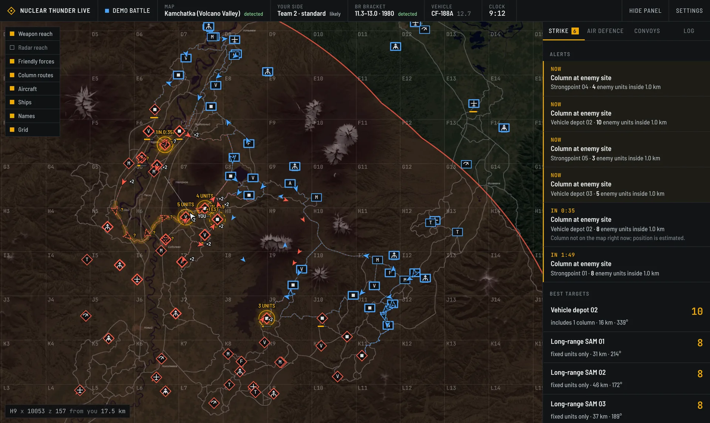

# Nuclear Thunder Live

A live companion map for War Thunder's **Nuclear Escalation** event, for Windows.

It reads what the game itself reports while you play and turns it into a planning map: which air defences are still alive, where enemy columns are (even after they drop off your map), and where enough enemies are bunched together to be worth a nuclear strike.

## What it does

| | |
|---|---|
| **Knows your battle** | Works out the map, your team and the BR bracket by itself within seconds of spawning. You can override any of them from the top bar. |
| **Tracks what is destroyed** | Reads the in-game kill feed and watches the map. A destroyed SAM launcher is crossed out and its range ring disappears. Each call is labelled *confirmed*, *probable* or *marked by you*. |
| **Follows enemy columns** | Supply and armoured columns are followed while visible. When they are no longer spotted, the app keeps estimating where they are along their road and shows how sure it is. |
| **Points out strike targets** | When a column drives next to a depot or strongpoint, that area lights up softly on the map and in the mini map, with a countdown before it happens. |
| **Shows where you are hidden** | Terrain cover: the parts of the map where enemy air defence can actually see you at your current altitude, with hills and mountains blocking the rest. |
| **Lists the nearest SAM sites** | Numbered 1-10 with distance, bearing and grid square, nearest first, so you can drop the game's aiming points on them quickly. |
| **Stays current** | Map data is rebuilt automatically from the public War Thunder datamine after game updates and downloaded by the app. No reinstall needed. |
| **Works without the game** | Study any map, side and BR bracket offline, or run the built-in demo battle. |

## Install

1. Open the [latest release](https://github.com/n0-0one/Nuclear-Escalation-map-with-localhost-app-V2/releases/latest).
2. Download **Nuclear-Thunder-Live-Setup.exe** and run it. (Or download the portable ZIP, unpack it anywhere and run `Nuclear-Thunder-Live.exe`.)
3. Start War Thunder. The app connects by itself.

Windows may show a "Windows protected your PC" notice because the installer is not signed with a paid certificate. Choose **More info → Run anyway**. The app needs the Microsoft Edge WebView2 runtime, which Windows 10 and 11 normally already have; the installer fetches it if it is missing.

## Use it

- **Top bar** - connection state, then *Map*, *Your side* and *BR bracket*. A small word next to each tells you how it was found: `detected`, `likely`, `guess` or `set by you`. Click one to change it.
- **Map** - drag to move, scroll to zoom, Shift-drag to measure distance and bearing. Diamonds are enemy sites, rectangles are friendly ones. Zoom in to see every vehicle of a site. Click a site for its units, ranges and status.
- **Strike** - alerts and the best places to hit right now.
- **Air defence** - the ten nearest live enemy SAM sites.
- **Convoys** - every column, where it is going and when it arrives, plus when each depot sends its next one.
- **Log** - what happened, with the battle clock.
- **Settings** - blast radius to plan with, alert timing, the mini map window, the demo battle and data updates.

For the mini map window to stay on top of the game, run War Thunder in **borderless** or **windowed** mode.

## Is it allowed? Is it safe?

The app only reads the small web page War Thunder itself serves on your own computer at `127.0.0.1:8111` (the same one behind the game's browser map). It does not read the game's memory, change its files, inject anything or press keys for you, and it sends nothing about you or your battles to the internet. The only thing it downloads is map data, from this repository.

Gaijin can change or restrict that local page at any time. If they do, the app says so instead of guessing.

## Good to know

- **Aiming points are placed by you.** The game only accepts aiming points from mouse clicks on its own tactical map; it offers no way for another program to set them, and faking your mouse would break the "one key, one action" rule. The app does the next best thing: it tells you exactly which sites to click, in order.
- **Enemy units are only on your map while a teammate or friendly radar detects them.** So "left the map" does not always mean "destroyed". The app only calls a unit destroyed when the kill feed names it, or when it vanishes while its neighbours stay visible.
- **Estimated columns are estimates.** The amber band on the road shows how far off the position may be.
- **Blast radius is your setting.** The game files give each bomb's yield but not its blast radius.
- This build has been tested against a simulated battle built from the real mission data, not yet against every situation in a real match. If something looks wrong, use *Settings → Record this battle to a file* and attach the file to an issue.

## Where the data comes from

- **Read directly from the public [War Thunder datamine](https://github.com/gszabi99/War-Thunder-Datamine) by this project:** every unit position for all maps, both side layouts and all BR brackets, convoy links, battle ratings, unit names and kill-feed wording.
- **From [Nuclear Thunder Interactive Map](https://github.com/majorlier/nuclear-thunder-interactive-map) by majorlier, which this project builds on:** weapon and radar ranges, mission rule constants, and terrain, roads and map pictures (those three exist only in the installed game, not in the datamine).
- **How aiming points work:** Gaijin's official news posts.

See [NOTICE.md](NOTICE.md) for full credits. This is a fan project and is not affiliated with Gaijin Entertainment.

## More

- [How it works](docs/how-it-works.md)
- [Map data and updates](docs/data-updates.md)
- [Building from source](docs/development.md)
